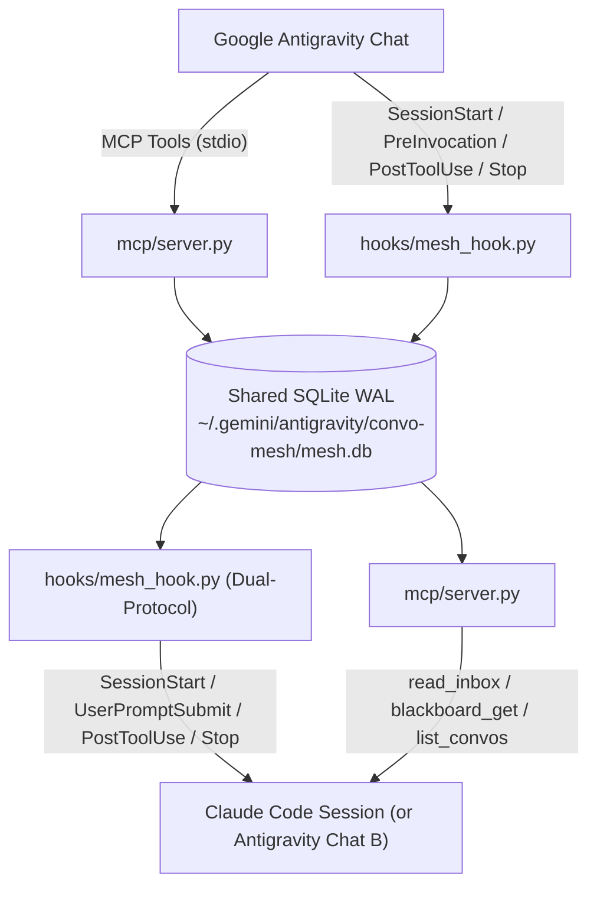

# Convo Mesh (`antigravity-convo-mesh`)

[](https://github.com/aashim0821/antigravity-convo-mesh/actions/workflows/ci.yml)
[](LICENSE)
[](https://www.python.org/)
[-brightgreen.svg)](#architecture)

**Cross-conversation & cross-agent (`Google Antigravity <-> Claude Code`) coordination bus** — packaged as a native **Antigravity Plugin**, a **Claude Code Plugin**, and a portable **`SKILL.md` Agent Skill**.

Separate chats — and separate AI coding agents — normally live in isolated worlds. **Convo Mesh** links every **Antigravity** conversation and every **Claude Code** session on your machine through a single local **SQLite WAL** database (`~/.gemini/antigravity/convo-mesh/mesh.db`).

---

## What It Solves

- **Live Antigravity ↔ Claude Code Bridge (`target_type: "client"`):** Tell Antigravity *"Send a message to Claude Code to run the integration tests"*, switch to Claude Code, and Claude receives it automatically on your next prompt (and vice versa).
- **Automatic Quota-Failover Continuity:** Every turn automatically checkpoints your workspace, goal, last prompt, and modified files. If Antigravity hits a quota wall mid-task and you open Claude Code in the same folder (or switch the other way), `SessionStart` injects `[CONVO-MESH WORKSPACE CONTINUITY]` so the new agent picks up right where you left off with **zero manual copy-pasting**.
- **Focus Guard (`soft` & `strict` locks):** Studying in Chat A and drift into another Antigravity or Claude Code chat? Chat B automatically receives a reminder at the start of the turn — or blocks off-topic execution completely in `strict` mode until you unlock or snooze.
- **Cross-Chat Messaging (`convo`, `alias`, `workspace`, `client`, `broadcast`):** Leave instructions, reminders, or updates from one chat and have them delivered automatically with **exact-once delivery deduplication**.
- **Shared Blackboard:** Store JSON facts, ports, schema choices, and architectural decisions under namespaces (`global`, `api`, `study`, etc.) readable from both Antigravity and Claude Code.
- **Parallel File Collision Warnings:** Automatically tracks `write_file`/`edit_file` (Antigravity) and `Write`/`Edit`/`MultiEdit` (Claude Code) via `PostToolUse` hooks and warns you if another active session recently modified files in the same workspace.

---

## Architecture



### Why It's Fast & Safe
- **Zero third-party dependencies:** Pure Python 3.10+ standard library (`sqlite3`, `json`, `sys`). No `venv` drift or package install steps.
- **Fail-open hooks:** Every lifecycle hook catches errors to `~/.gemini/antigravity/convo-mesh/hook_errors.log`, returns `{}` on stdout, and exits `0` so it can never block a turn.
- **100% local & private:** Everything stays in `~/.gemini/antigravity/convo-mesh/mesh.db`. Zero network calls, zero telemetry.

---

## Installation

### 1. Google Antigravity (Full Global Plugin: Hooks + MCP + Rules + Skill)

**Windows (PowerShell):**
```powershell
git clone https://github.com/aashim0821/antigravity-convo-mesh.git
cd antigravity-convo-mesh
powershell -ExecutionPolicy Bypass -File .\install.ps1
```

**macOS / Linux:**
```bash
git clone https://github.com/aashim0821/antigravity-convo-mesh.git
cd antigravity-convo-mesh
chmod +x install.sh
./install.sh
```

### 2. Claude Code (Full Plugin: Hooks + MCP + Skill)

Run these two commands inside Claude Code:
```text
/plugin marketplace add aashim0821/antigravity-convo-mesh
```
```text
/plugin install convo-mesh@convo-mesh
```

Both installations automatically connect to the **exact same local SQLite database** (`~/.gemini/antigravity/convo-mesh/mesh.db`), bridging Antigravity and Claude Code out of the box.

---

## 30-Second Live Test (Antigravity ↔ Claude Code)

1. **In Antigravity:**
   > *"Send a message to `client:claude-code` saying: 'Pick up the auth refactor in `src/auth.ts`'."*
2. **In Claude Code (or a second Antigravity chat):** Send any prompt.
3. `hooks/mesh_hook.py` automatically injects `[CONVO-MESH INCOMING MESSAGE]` (plus `[CONVO-MESH WORKSPACE CONTINUITY]` if you're in the same repo) before the model replies!

---

## MCP Tools & Resources

| Tool | Purpose |
|---|---|
| `register_convo` | Register or update a conversation's alias, `client` (`antigravity`/`claude-code`), workspace, goal, and status |
| `list_convos` | List active conversations across Antigravity and Claude Code workspaces |
| `set_focus_lock` | Set a `soft` (nudge) or `strict` (block off-topic work) focus lock with optional expiry & allowed workspaces |
| `get_focus_status` | Inspect active and snoozed focus locks |
| `snooze_focus_lock` | Temporarily pause focus enforcement for N minutes |
| `clear_focus_lock` | Deactivate focus locks by ID, owner, or globally |
| `send_message` | Send messages addressed by `convo`, `alias`, `workspace`, `client` (`claude-code`/`antigravity`), or `broadcast` |
| `read_inbox` | List incoming messages and delivery/acknowledgement status |
| `ack_messages` | Mark specific or all inbox messages as acknowledged |
| `blackboard_set` | Store a JSON key-value entry in a shared namespace (optional TTL) |
| `blackboard_get` | Read one entry or list all entries in a namespace (`*` for all) |
| `blackboard_delete` | Delete a key from the shared blackboard |
| `create_handoff` | Publish a structured summary, `next_steps`, and `key_files` for the next chat or specific `client` |
| `get_workspace_activity` | Inspect recent file edits across Antigravity and Claude Code for collision awareness |

**MCP Resources:**
- `convo-mesh://status` — Live snapshot of active conversations, locks, message counts, and blackboard entries.
- `convo-mesh://blackboard` — All active blackboard entries across all namespaces.

---

## CLI Usage

```bash
python cli.py status
python cli.py focus --goal "Finish API refactor" --mode strict --minutes 45
python cli.py clear-focus
python cli.py send --type client --to claude-code --body "Continue tests from Antigravity"
python cli.py blackboard --ns api --key base_url --set-json '"http://localhost:8000"'
python cli.py reset-db --yes
```

---

## Running Tests

```bash
python -m unittest discover -s tests -v
```

---

## License

[MIT](LICENSE) © 2026 Aashim Anis Ahamed
