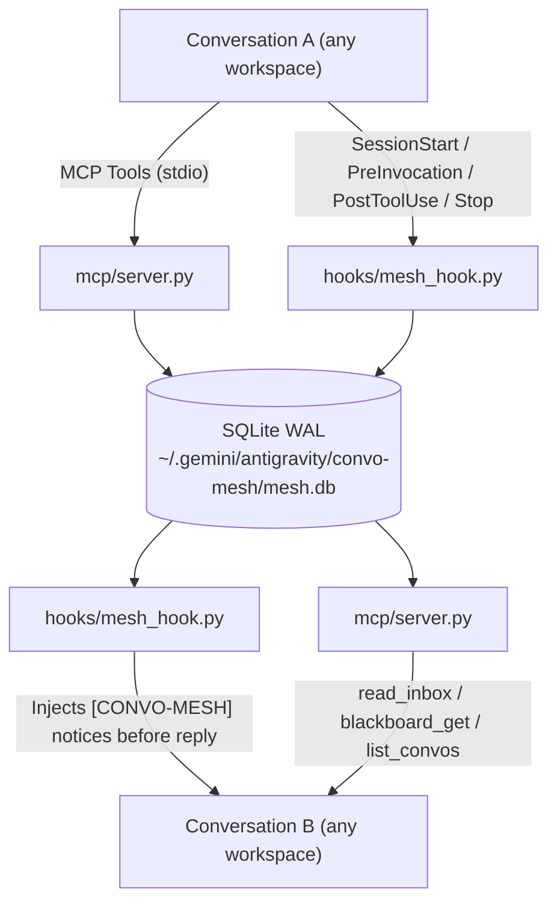

# Convo Mesh (`antigravity-convo-mesh`)

[](https://github.com/aashim0821/antigravity-convo-mesh/actions/workflows/ci.yml)
[](LICENSE)
[](https://www.python.org/)
[-brightgreen.svg)](#architecture)

**Whole-Antigravity cross-conversation coordination** — packaged as a native **Antigravity Plugin** (Lifecycle Hooks + Stdio MCP Server + Global Rules) and a portable **`SKILL.md` Agent Skill**.

Separate top-level Antigravity chats normally live in isolated loops. **Convo Mesh** connects every conversation across every workspace through a shared local **SQLite WAL** bus so your chats stay aligned automatically.

---

## What It Solves

- **Focus Guard (`soft` & `strict` locks):** Studying in Chat A and drift into another chat? Chat B automatically receives a reminder at the start of the turn — or blocks off-topic execution completely in `strict` mode until you unlock or snooze.
- **Cross-Chat Messaging (`convo`, `alias`, `workspace`, `broadcast`):** Leave instructions, reminders, or updates from one chat and have them delivered automatically on the recipient chat's next prompt with **exact-once delivery deduplication**.
- **Shared Blackboard:** Store JSON facts, ports, schema choices, and architectural decisions under namespaces (`global`, `api`, `study`, etc.) readable from any conversation.
- **Parallel File Collision Warnings:** Automatically tracks `write_file` / `edit_file` activity via `PostToolUse` hooks and warns you if another active conversation recently modified files in the same workspace.
- **Structured Session Handoffs:** Drop a handoff packet (`summary`, `next_steps`, `key_files`) so your next conversation claims it automatically on `SessionStart` without re-explaining context.

---

## Architecture



### Why It's Fast & Safe
- **Zero third-party dependencies:** Pure Python 3.10+ standard library (`sqlite3`, `json`, `sys`). No `venv` drift or package install steps.
- **Fail-open hooks:** Every lifecycle hook catches errors to `~/.gemini/antigravity/convo-mesh/hook_errors.log`, returns `{}` on stdout, and exits `0` so it can never block a turn.
- **100% local & private:** Everything stays in `~/.gemini/antigravity/convo-mesh/mesh.db`. Zero network calls, zero telemetry.

---

## Installation

### Option 1: Full Global Plugin (Recommended — Hooks + MCP + Rules + Skill)

**Windows (PowerShell):**
```powershell
git clone https://github.com/aashim0821/antigravity-convo-mesh.git
cd antigravity-convo-mesh
powershell -ExecutionPolicy Bypass -File .\install.ps1
```

**macOS / Linux:**
```bash
git clone https://github.com/aashim0821/antigravity-convo-mesh.git
cd antigravity-convo-mesh
chmod +x install.sh
./install.sh
```

The installer:
1. Auto-detects Python 3.10+ on your machine.
2. Installs the plugin to `~/.gemini/config/plugins/convo-mesh/`.
3. Writes `hooks.json` and `mcp_config.json` with your exact Python executable path.
4. Runs an isolated smoke test (using a temporary DB) to confirm hooks and all 14 MCP tools work.

**Uninstall:**
```powershell
# Windows
.\install.ps1 -Uninstall
```
```bash
# macOS / Linux
./install.sh --uninstall
```

### Option 2: Standalone `SKILL.md` Only (Project or Global Skill)
Copy [`skills/convo-mesh/`](skills/convo-mesh/) into `.agents/skills/convo-mesh/` (project-scoped) or `~/.gemini/config/skills/convo-mesh/` (global). *(Note: Standalone skill mode gives the agent the workflow instructions and `cli.py` commands, whereas Option 1 adds automatic `PreInvocation` hook injection and the 14 native MCP tools.)*

---

## 30-Second Live Test Across Two Chats

1. Open a **new Antigravity conversation** (check **Additional Options (...) > MCP Servers** or **Skills & Customizations** to verify `convo-mesh` loaded).
2. **In Chat 1:**
   > *"Register this conversation as `learning` and set a `soft` focus lock for `'Mastering Rust ownership'`."*
3. **Open Chat 2** (in any workspace) and send any unrelated prompt:
   > *"Help me design a landing page."*
4. Before Chat 2 replies, `hooks/mesh_hook.py` injects `[CONVO-MESH FOCUS REMINDER]`, and Chat 2 immediately reminds you about your active `learning` focus session!

---

## MCP Tools & Resources

| Tool | Purpose |
|---|---|
| `register_convo` | Register or update a conversation's alias, workspace, current goal, and status |
| `list_convos` | List active conversations across all workspaces within a lookback window |
| `set_focus_lock` | Set a `soft` (nudge) or `strict` (block off-topic work) focus lock with optional expiry & allowed workspaces |
| `get_focus_status` | Inspect active and snoozed focus locks |
| `snooze_focus_lock` | Temporarily pause focus enforcement for N minutes |
| `clear_focus_lock` | Deactivate focus locks by ID, owner, or globally |
| `send_message` | Send messages addressed by `convo`, `alias`, `workspace`, or `broadcast` |
| `read_inbox` | List incoming messages and delivery/acknowledgement status |
| `ack_messages` | Mark specific or all inbox messages as acknowledged |
| `blackboard_set` | Store a JSON key-value entry in a shared namespace (optional TTL) |
| `blackboard_get` | Read one entry or list all entries in a namespace (`*` for all) |
| `blackboard_delete` | Delete a key from the shared blackboard |
| `create_handoff` | Publish a structured summary, `next_steps`, and `key_files` for the next chat |
| `get_workspace_activity` | Inspect recent file edits across conversations for collision awareness |

**MCP Resources:**
- `convo-mesh://status` — Live snapshot of active conversations, locks, message counts, and blackboard entries.
- `convo-mesh://blackboard` — All active blackboard entries across all namespaces.

---

## CLI Usage

```bash
python cli.py status
python cli.py focus --goal "Finish API refactor" --mode strict --minutes 45
python cli.py clear-focus
python cli.py send --type alias --to frontend --body "Updated OpenAPI schema"
python cli.py blackboard --ns api --key base_url --set-json '"http://localhost:8000"'
python cli.py reset-db --yes
```

---

## Running Tests

```bash
python -m unittest discover -s tests -v
```

---

## License

[MIT](LICENSE) © 2026 Aashim Anis Ahamed
